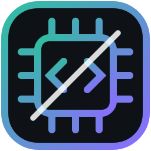
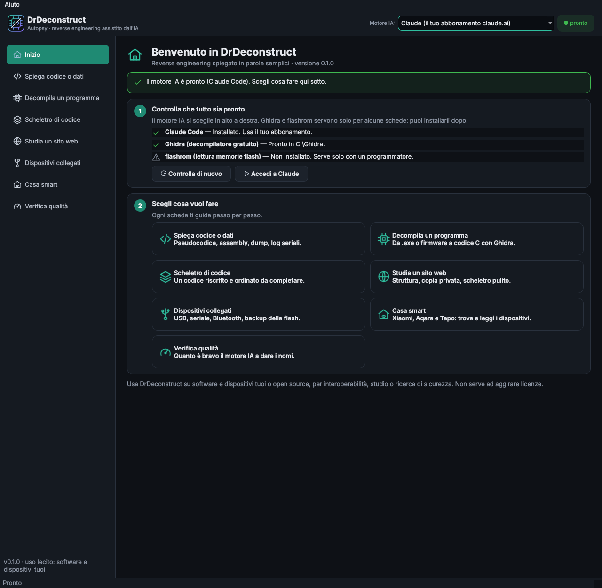
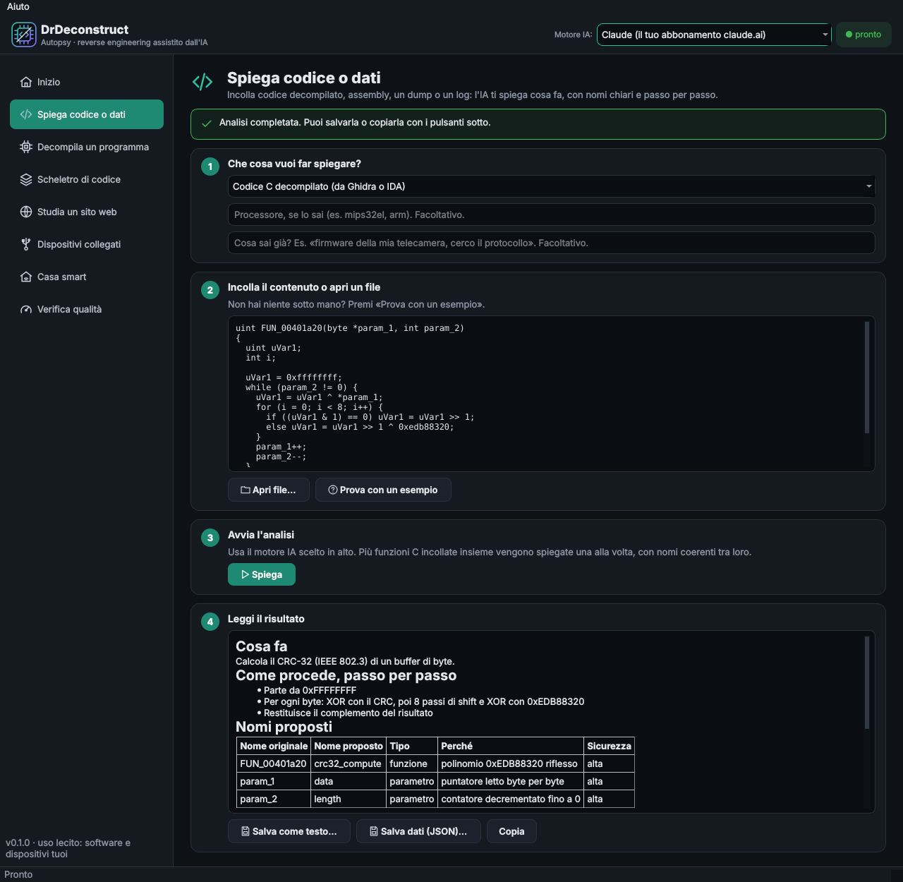
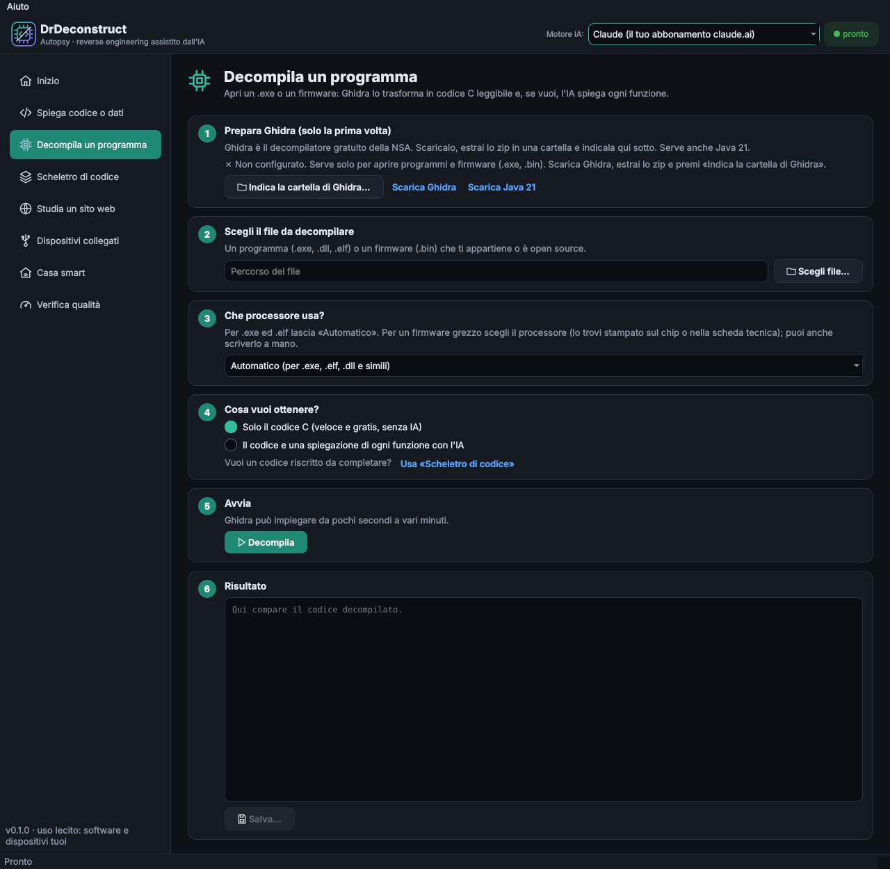
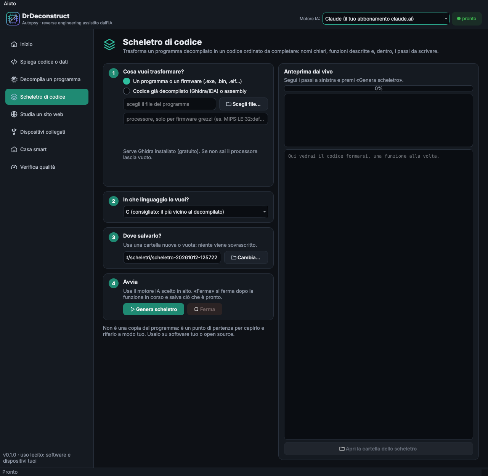
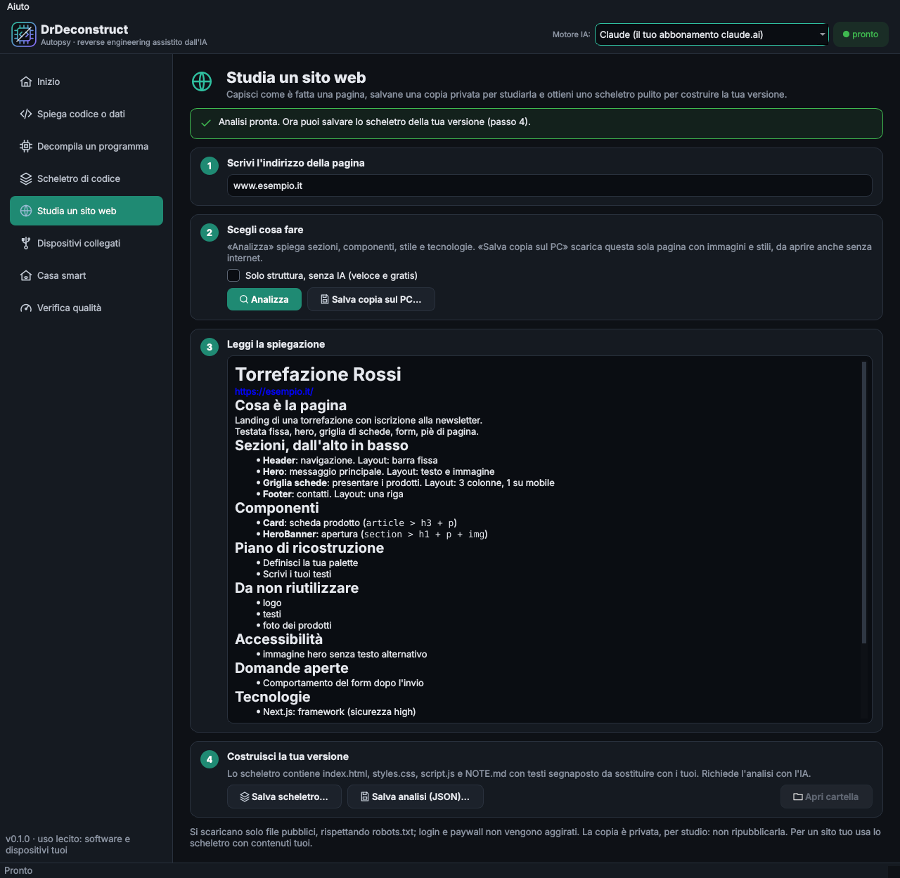
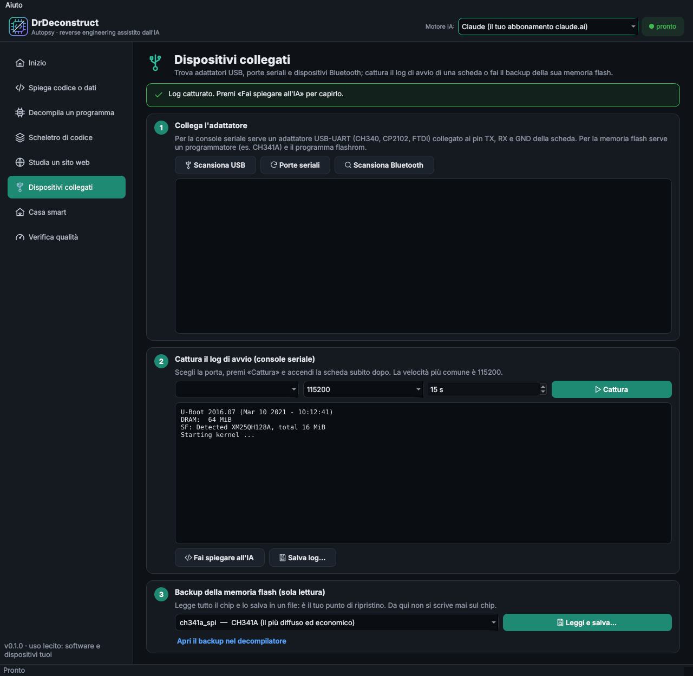
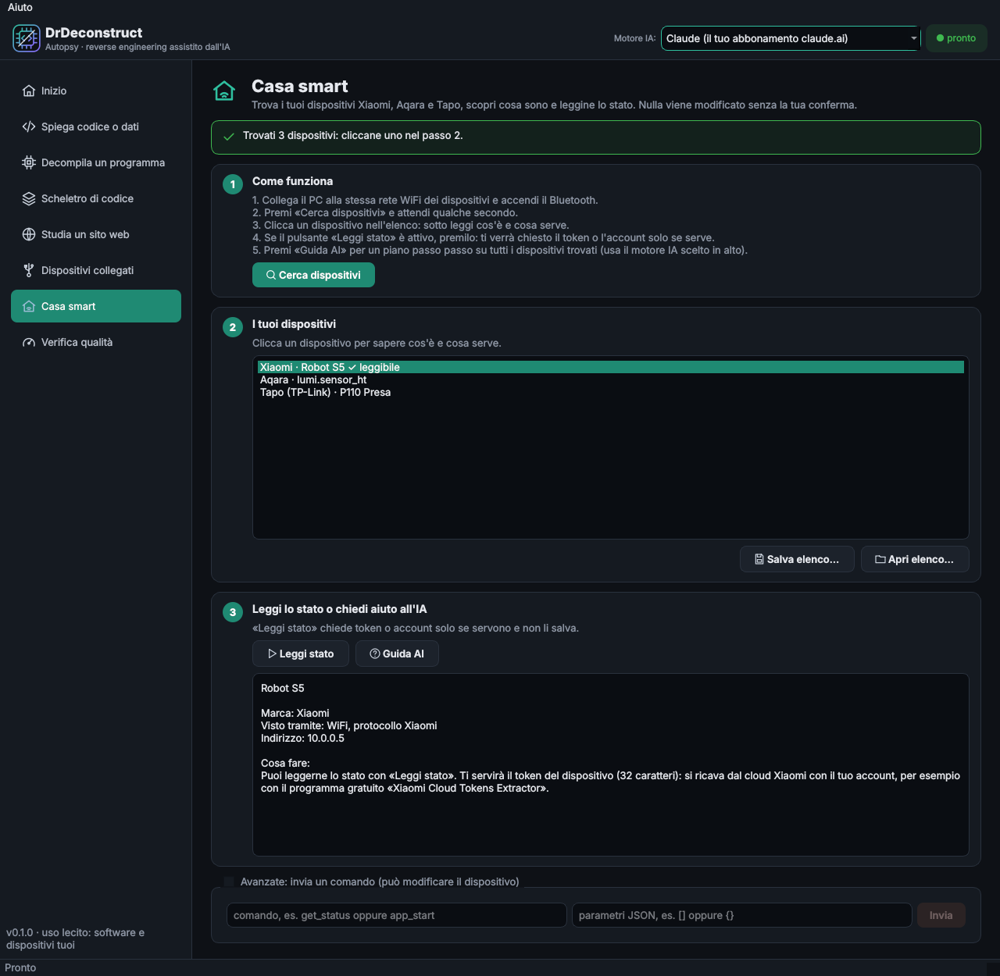

<div align="center">



```text
  ____       ____                      _                   _
 |  _ \ _ __|  _ \  ___  ___ ___  _ __ | |_ _ __ _   _  ___| |_
 | | | | '__| | | |/ _ \/ __/ _ \| '_ \| __| '__| | | |/ __| __|
 | |_| | |  | |_| |  __/ (_| (_) | | | | |_| |  | |_| | (__| |_
 |____/|_|  |____/ \___|\___\___/|_| |_|\__|_|   \__,_|\___|\__|
```

### Open the box. Understand what's inside. 🔬

**AI-assisted reverse engineering for people who just want answers:**
decompiled code, firmware dumps, serial logs, smart-home gadgets and websites,
explained in plain language, step by step, from a friendly desktop app.

[](https://github.com/VjAlbert/autopsy/releases/latest)
[](https://github.com/VjAlbert/autopsy/releases/latest)

[](https://github.com/VjAlbert/autopsy/actions/workflows/ci.yml)




</div>

---

## Why DrDeconstruct?

Ghidra, IDA and binwalk are superb, but their output is a wall of `FUN_00401a20`, `param_1` and hex.
DrDeconstruct takes that output and a language model, and gives you back **what the code does, with
real names**, in a desktop app that walks you through every step. No terminal required.

- 🧭 **Guided, step by step.** Every page is a numbered checklist with plain-language hints and clear errors.
- 🧠 **Names that stay consistent.** Two-pass analysis: `FUN_00401a20` is `crc32_update` in *every* function that calls it.
- 🔌 **From chip to explanation.** Capture a UART boot log, back up a flash chip, decompile it, understand it.
- 🏠 **Smart-home friendly.** Find your Xiaomi, Aqara and Tapo devices and learn how to talk to each one.
- 🔒 **Safe by default.** Read-only first; every write needs a backup, an explicit confirmation and a read-back check.
- 💸 **No API key needed.** Use your own Claude subscription, or run a model locally with Ollama.

## Download for Windows

> **Easiest way:** grab the installer from the [**Releases page**](https://github.com/VjAlbert/autopsy/releases/latest).

| File | Use it when |
|---|---|
| `DrDeconstruct-Setup-<version>.exe` | **Recommended.** Double-click, follow the wizard. Installs for your user, no admin rights. |
| `DrDeconstruct-portable.exe` | You prefer a single file you can run from anywhere, no install. |
| `SHA256SUMS.txt` | You want to verify your download. |

No Python needed. Windows 10 and 11, 64-bit.

<details>
<summary><b>"Windows protected your PC" (SmartScreen): is it safe?</b></summary>

The first time you run the app Windows may show a blue **"Windows protected your PC"** window.
This happens to every program that is not code-signed with a paid certificate, and DrDeconstruct is an
open-source hobby-scale project that is not signed yet. To continue:

1. Click **More info**.
2. Click **Run anyway**.

You only need to do this once. If you want to be sure the file is the one built by this repository, compare
its SHA-256 with `SHA256SUMS.txt` in the release:

```powershell
Get-FileHash .\DrDeconstruct-Setup-0.1.0.exe -Algorithm SHA256
```

The whole build is public: see [`release.yml`](.github/workflows/release.yml). Prefer not to trust a binary at all?
[Run it from source](#run-from-source).
</details>

On the first launch, the **Start** page checks what is ready and fixes what it can with one click:

| Check | What the app does for you |
|---|---|
| Claude Code (default engine, uses your claude.ai subscription) | **Install Claude Code** and **Sign in to Claude** buttons open the official installer and login. |
| Ollama (optional local engine) | Tells you whether it is running and which model to pull. |
| Ghidra + Java 21 (to decompile programs) | Links to the downloads, and **Pick the Ghidra folder** remembers it. |
| flashrom (to read memory chips) | Only needed with a programmer such as a CH341A. |

## Tour

| | |
|---|---|
| **Explain code or data**<br>Paste decompiled C, assembly, a hex dump, a register map or a bus log. Get a readable explanation with renamed symbols, not JSON.<br> | **Decompile a program**<br>Pick an `.exe`, `.elf` or raw firmware and a processor from a friendly list; Ghidra does the rest, the AI explains every function.<br> |
| **Code skeleton**<br>Turns a decompiled program into tidy C, Python or Rust to complete: clear names, documented functions, the flow as comments. Watch it form live; **Stop** keeps what is done.<br> | **Study a website**<br>Understand structure, components, design tokens and tech stack; keep a private offline copy of one page; get a clean skeleton for your own version.<br> |
| **Connected devices**<br>List USB adapters, serial ports and Bluetooth devices, capture a UART boot log, back up a flash chip, and send the log straight to the explainer.<br> | **Smart home**<br>Discover Xiaomi, Aqara and Tapo devices, see what each one is, read state when you have the token or account, get an AI plan for the rest.<br> |

A **Quality check** page measures how well the chosen engine guesses real function names (CRC32, `strlen`, UART drivers...).
The screenshots above are generated from the GUI itself by [`scripts/make_screenshots.py`](scripts/make_screenshots.py).

## AI engines (no API key required)

Pick one in the top bar; it applies to every page.

| Engine | How it works | Cost |
|---|---|---|
| **Claude Code** (default) | Runs the `claude` CLI headless with your claude.ai login and all tools disabled, so analyzed code can never make the model run anything | Uses your subscription limits |
| **Ollama** | A local model via `ollama serve` | Free and offline, needs a decent GPU |
| **Anthropic API** | Official SDK with `ANTHROPIC_API_KEY` | Pay-per-use, off by default |

The Claude Code engine strips `ANTHROPIC_API_KEY` from the subprocess environment, so it always uses the subscription.
If the model refuses a firmware snippet, the app retries once with a fallback model and tells you what to try.

## Modules

| Module | Input | Output |
|---|---|---|
| **Software** | C pseudocode (Ghidra/IDA) or assembly, or a whole binary via headless Ghidra | Purpose, control flow, renamed symbols, rewritten code, algorithm notes, open questions |
| **Hardware** | Hex dump excerpts, register maps, UART/SPI/I2C/CAN logs | Recognized format, decoded fields, structures, pin and register hypotheses |
| **Acquisition** | USB, serial and Bluetooth LE devices, flash chips via `flashrom` | Boot logs and memory images, with mandatory backup, confirmation and read-back before any write |
| **Smart home** | Bluetooth LE (MiBeacon), miIO, Tapo discovery and KLAP, mDNS | Device inventory, state readouts, an AI guide per device |
| **Web** | A public URL or a saved HTML file | Sections, components, design system, stack, rebuild plan, placeholder HTML/CSS skeleton, private one-page mirror |
| **Code skeleton** | Decompiled functions | A completable C/Python/Rust source with consistent names and a `NOTE.md` |

The operator **declares** the input type; the heuristic detector is only a fallback and stops to ask when unsure.

### Smart-home channels and honest limits

| Channel | What it sees | What you need to read state |
|---|---|---|
| Bluetooth LE (MiBeacon) | Xiaomi and Aqara sensors, pairing of robots and plugs | Nothing for plain advertisements; the bindkey from the Xiaomi cloud if encrypted |
| miIO (UDP 54321) | Xiaomi WiFi devices, robot vacuums included | The device's 32-character token |
| Tapo discovery (UDP 20002) | Tapo plugs, bulbs, hubs, cameras | TP-Link email and password (KLAP); cameras use RTSP/ONVIF |
| mDNS | Aqara hubs (HomeKit), Xiaomi, robots running Valetudo, Matter | Depends; Valetudo asks for nothing |

Zigbee Aqara sensors are not reachable from a PC without the hub or a USB Zigbee stick. Rooting a robot vacuum is explained,
never performed. Read-only methods always pass; anything that changes a device needs explicit confirmation. Tokens and
passwords are asked only when needed, are never stored, and are never sent to the model.

### Websites: study and reinterpret, do not clone

It fetches only what a browser already receives, respects `robots.txt` and `Crawl-delay`, never bypasses logins, paywalls
or anti-scraping (401, 403 and 429 stop the collection), and sends neither site text nor images to the model.
The optional mirror is **one page, private, for study**; a `LEGGIMI.txt` in it reminds you not to republish it.
A site's look can be protected (copyright, trademarks, unfair competition) and its terms of use may forbid automated
collection: the skeleton is a starting point to reinterpret, not something to republish.

## Run from source

```bash
git clone https://github.com/VjAlbert/autopsy && cd autopsy
python -m venv .venv && source .venv/bin/activate     # Windows: .venv\Scripts\activate
pip install -e ".[gui,smarthome,hardware]"
drdec-gui                                              # the desktop app
```

For the default engine install [Claude Code](https://code.claude.com/docs/en/setup) and run `claude` once to sign in
(the app's Start page can do both). For a local engine: `ollama pull qwen2.5-coder:14b`.

## Command line

Everything the app does is also available as `drdec` for scripting:

```bash
drdec doctor                                          # what is ready, what is missing
drdec decompile program.exe --analyze -o result.json  # Ghidra decompiles, the model explains
drdec decompile firmware.bin --processor MIPS:LE:32:default --filter "^FUN_" --analyze
drdec analyze function.c --kind pseudocode_c --arch mips32el
drdec analyze ghidra_export.c --kind pseudocode_c --split -o result.json
drdec scaffold ghidra_export.c --out skeleton/ --lang python
drdec analyze uart.log --kind bus_log --backend ollama
drdec web https://example.com --snapshot-only         # structure only, no model, free
drdec web https://example.com --scaffold my-site/ -o analysis.json
drdec web https://example.com --mirror study-copy/    # private one-page copy
drdec home scan -o home.json                          # smart-home inventory
drdec home guide --inventory home.json
drdec home miio 192.168.1.50                          # asks for the token
drdec home tapo 192.168.1.60                          # asks for the TP-Link account
drdec eval                                            # score the model's naming
```

Environment variables: `DRDEC_BACKEND`, `DRDEC_MODEL`, `DRDEC_OLLAMA_HOST`, `DRDEC_FALLBACK_MODEL`.
Decompiling needs Ghidra (free) with Java 21 and `GHIDRA_INSTALL_DIR`; the app can remember the folder for you.

### Consistent names across functions

With several functions, analysis runs in two passes. The model first sees them all and assigns one name to every opaque
function and global (`FUN_`, `DAT_`, `sub_`); then each function is analyzed with those names already applied, so a global
never changes name between functions. Uncertain names stay as hints. The result has a `symbol_map` and a `functions` section;
`--no-global-names` skips the first pass.

## Project layout

```text
src/drdeconstruct/
├─ cli.py            `drdec` command          ├─ doctor.py     "what is ready?" checks
├─ config.py         settings from env        ├─ report.py     results as readable Markdown
├─ core/             types, fallback detector, orchestrator
├─ llm/              engines: claude_code, ollama, anthropic_api
├─ software/         analyzer, cross-function names, code skeletons
├─ hardware/         schemas, prompts, analyzer (dumps, registers, buses)
├─ web/              polite fetcher, structure map, analysis, skeleton, mirror
├─ acquisition/      USB, serial, Bluetooth, flash (with safety checks)
├─ smarthome/        Xiaomi, Aqara, Tapo: discovery, miIO, KLAP, Valetudo, AI guide
├─ preprocess/       headless Ghidra bridge and function splitting
├─ evaluation.py     rename scoring (`drdec eval`) + eval_cases/
└─ gui/              PySide6 app: theme, icons, components, one module per page
```

## Development

```bash
pip install -e ".[dev,gui,smarthome]"
pytest            # fake model, no network, no hardware
ruff check . && ruff format --check .
QT_QPA_PLATFORM=offscreen python scripts/make_screenshots.py   # regenerate docs/screenshots
```

See [CONTRIBUTING.md](CONTRIBUTING.md). Windows packaging is documented in [`packaging/`](packaging/README.md).

## Legitimate use

Built for interoperability, security research, education and the analysis of your own software and devices. Decompiling
proprietary software is allowed only within the limits of the law in your country (for example the EU Software Directive,
Art. 6), and decompiled code must not be reused: to write your own version, start from the functional specification (clean room).
DrDeconstruct is not meant to circumvent licenses, DRM or access controls.

## License

[MIT](LICENSE)
